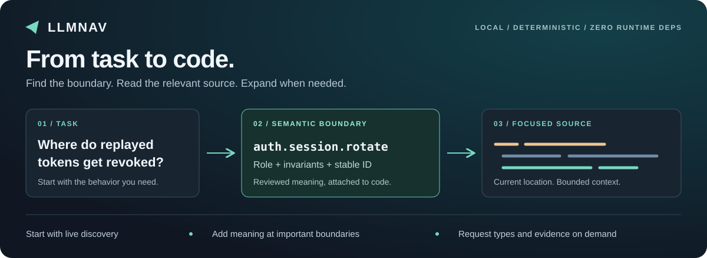
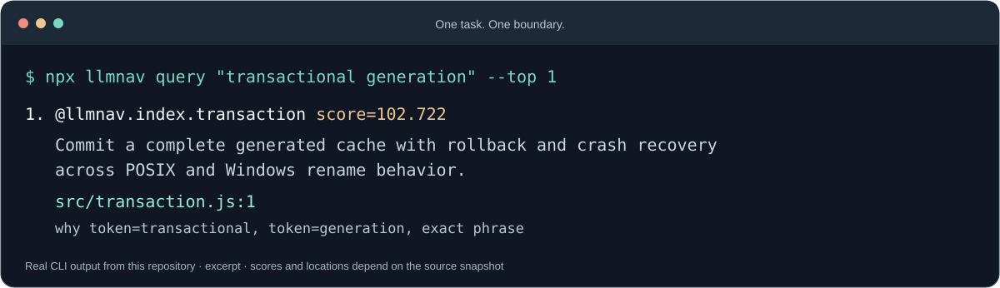

# LLMNav

**Give coding agents a map of your codebase.**

Find code by what it does, keep important business rules attached to stable IDs, and expand into source, types, or related boundaries only when the task needs them.



[Quick start](docs/quickstart.md) · [CLI reference](docs/cli.md) · [Agent integration](docs/agent-integration.md) · [Language analysis](docs/precise-analysis.md) · [Evaluation results](docs/token-cost-review.md)

LLMNav is a local Node.js CLI and ESM library with **zero runtime dependencies**. Its core navigation needs no API key, hosted service, or embedding database. Node.js **22+** is required.

## See it work

Ask about a responsibility instead of guessing a filename. This example comes from LLMNav's own source checkout:

```sh
npx llmnav query "transactional generation" --top 1
```



The result gives an agent a stable boundary ID, a current location, and the reason it matched. Open that source; request `show` or `context` when more contract or relationship detail is needed.

## Install

With npm:

```sh
npm install --save-dev llmnav
```

With Bun:

```sh
bun add --dev llmnav
```

Use `npx llmnav ...` or `bunx llmnav ...` for the commands below. Global installation is also supported with `npm install --global llmnav` or `bun add --global llmnav`.

Both package runners require Node.js 22+: the CLI uses a Node shebang. Installation never edits your project through a `postinstall` hook.

## Start without annotating anything

Replace `rotateSession` with a symbol or task from your repository:

```sh
npx llmnav discover "rotateSession" --top 1 --include-source --source-budget 4000 --json
```

Discovery works **before initialization or index generation**. It ranks live paths, declaration names, and signatures, and can return a source excerpt. The 4,000-byte budget covers excerpt text; JSON metadata is additional. Inspect more when the excerpt is incomplete.

Already know the file and identifier? A direct read or exact text search is usually the right first step.

## Choose the right route

| What you know | Start with | What you get |
| --- | --- | --- |
| An exact file or identifier | Your editor, a bounded read, or `rg` | Direct access to known code |
| A name or rough task, with no cards yet | `llmnav discover "<task>" --top 1 --include-source` | Live candidates and an optional excerpt |
| A business responsibility captured in cards | `llmnav query "<task>" --top 3` | Ranked semantic boundaries |
| A semantic ID | `llmnav show <id>` | Its role, rules, and generated location |
| Missing policy or workflow context | `llmnav context <id> --depth 1 --budget 2500` | A bounded bundle of related boundaries |
| Types, signatures, or members | Opt-in `analyze --metadata`, then `show --metadata` | Saved compiler or syntax metadata, with paging |
| File provenance | `llmnav history <file> --json` | Last file commit and staged, unstaged, or untracked state |

Semantic queries use generated cards and indexes. Compiler metadata requires the [analysis setup](docs/precise-analysis.md); file history requires Git.

For a repair spanning several files, MCP/provider-neutral `llmnav_query` can return compact cards and live source windows together with `includeSource:true` and specific `sourceTerms`, such as `["maxEdges", "--max-edges"]`. Reuse sufficient windows before another read; [source budgets and omissions](docs/api.md#agent-operation-protocol) remain explicit.

## Add meaning where it matters

Use cards for architectural modules, public entry points, authentication, payments, privacy, and code with non-obvious invariants. Start with one useful boundary.

```sh
npx llmnav init --agents all --package-scripts
npx llmnav audit
```

Initialization creates configuration, the ID registry, generated catalogs, and managed agent instructions. Audit ranks candidates for review and leaves source unchanged. Use `--agents none` to skip agent instruction files.

After inspecting a candidate, attach a card to the matching declaration:

```ts
/* llmnav/1 symbol
id=auth.session.rotate
role=Rotate one refresh-token family atomically and reject replayed tokens.
search=refresh token|token rotation|token family|replay detection
invariant=At most one live refresh token exists per family.
invariant=Replay revokes the entire token family.
effect=db.write(session_tokens)|event.emit(auth.session.revoked)
risk=auth|concurrency
stability=contract
*/
export async function rotateSession(input: RotateSessionInput): Promise<RotateSessionResult> {
  // Your existing implementation.
}
```

The ID describes a durable capability and survives moves and renames. Paths, signatures, callers, and hashes are generated from code. Annotate selected boundaries; leave obvious helpers and generated files alone.

```sh
npx llmnav format
npx llmnav check
npx llmnav generate
npx llmnav query "replayed refresh token should revoke the family" --top 3
```

Add narrow coverage rules and real retrieval queries as you adopt more boundaries. The [quick start](docs/quickstart.md) walks through that workflow.

## Use it with your agent

| Integration | How it connects |
| --- | --- |
| Codex / other AGENTS.md readers | Managed instructions in `AGENTS.md` |
| Claude Code | Managed instructions in `CLAUDE.md` |
| GitHub Copilot | `.github/copilot-instructions.md` |
| Cursor | `.cursor/rules/llmnav.mdc` |
| MCP clients | `llmnav mcp`, using the shared agent tool schema |
| Custom hosts | ESM API, typed exports, and a [runnable host example](docs/provider-neutral-integration.md) |

For MCP editing sessions, `llmnav mcp --auto-generate` prepares indexes before semantic navigation requests. Reanalyze stale compiler inputs separately. The default MCP server reads existing indexes.

See [agent integration](docs/agent-integration.md) for setup and [editor integration](docs/editor-integration.md) for diagnostics.

## Language support

Source cards support multiple [comment styles](docs/language-examples.md). Optional analysis has a separate support boundary:

| Language | Analyzer | Useful details | Boundary |
| --- | --- | --- | --- |
| TypeScript | Installed TypeScript Compiler API 5 or 6 | Types, members, overloads, parameters, and resolved references | Supported Compiler API required |
| JavaScript | Installed TypeScript Compiler API 5 or 6 | Inferred types, signatures, and resolved references | Dynamic runtime behavior remains unresolved |
| Go | Installed Go toolchain | Types, fields, receiver methods, parameters, and resolved references | Active build constraints; excludes tests and cgo |
| Python | Installed Python 3.9+ AST parser | Explicit annotations, lexical ownership, and parameters | Syntax only; no inferred call edges |
| Rust | Built-in lexical extractor in an isolated Node process | Named types, fields, functions, and simple impl ownership | Partial syntax; no macro expansion or type checking |

Details are opt-in and paged: `llmnav show <id> --metadata --members --top 5 --metadata-budget 4000 --json`. Unknown types stay unknown. See [analysis setup, support, and limits](docs/precise-analysis.md).

## Keep meaning, structure, and evidence separate

| Layer | Owned by | Examples |
| --- | --- | --- |
| Reviewed meaning | Human or coding agent | Role, invariant, effects, risks, semantic relations |
| Generated structure | LLMNav and optional analyzers | Current location, signature, imports, types, references, hashes |
| On-demand evidence | Git and caller-reported verification records | Last file change, source version, command, outcome, evidence hash |

A file change date is distinct from a function change date or a passing test. [Verification receipts](docs/local-evidence.md) track declared inputs and evidence; incomplete applicability stays `unknown`. Volatile evidence stays out of deterministic navigation artifacts.

## Built for repeated repository work

- **Incremental indexing:** reuse unchanged file parses and card tokenization.
- **Recoverable generation:** stage and verify artifacts, serialize writers with a repository lock, and recover interrupted swaps.
- **Bounded context:** limit result count, source bytes, metadata pages, graph depth, edges, and context budgets.
- **Explainable retrieval:** deterministic lexical ranking, multilingual aliases, and regression queries.
- **Reviewable artifacts:** commit `.llmnav/cache`, the ID registry, and the stable order lock; keep volatile state and transaction files ignored.

See [architecture](docs/architecture.md), [graph provenance](docs/graph.md), [configuration](docs/configuration.md), and [CI checks](docs/ci.md) for the details.

## What the evaluations show

The [controlled coding pilot](docs/model-coding-evaluation.md) tested eight small repairs in each condition:

| Condition | Accepted repairs | Uncached input tokens, total |
| --- | ---: | ---: |
| Ordinary navigation | 8/8 | 96,393 |
| LLMNav 0.15.3 | 8/8 | 138,655 |
| Serena | 8/8 | 177,084 |

These are historical observations from one pilot completed on **2026-10-25**, not a benchmark of the current release. They support successful task completion in that fixture, while LLMNav used more uncached input than ordinary navigation.

The subsequent [token cost review](docs/token-cost-review.md) documents source excerpts and conditional routing, including cohorts that still showed higher token use. Use LLMNav when it helps locate an unclear responsibility or recover needed context, and measure its cost on your own tasks.

The [0.20.0 source-query follow-up](docs/multi-file-policy-evaluation.md#source-query-follow-up-0200) observed 8.7% less total input and 14.3% less time in one condition-adhering policy-repair pair. It also preserves a twelve-trial cohort that regressed against ordinary navigation and a flagged comparison pair. Broader savings remain unproven.

| Explore the evidence | Report |
| --- | --- |
| Multi-file policy repairs with optional and required semantic search | [Policy repair evaluation](docs/multi-file-policy-evaluation.md) |
| Identifier retrieval on real TypeScript and Go code | [Navigation pilot](docs/real-navigation-pilot.md) |
| Symbol lookup against Serena | [Serena comparison](docs/serena-comparison.md) |
| Compiler metadata accuracy, size, and lookup costs | [Metadata evaluation](docs/code-metadata-evaluation.md) |
| Python, Rust, and JavaScript support and costs | [Local analysis evaluation](docs/local-analysis-evaluation.md) |

## Documentation

| Goal | Read |
| --- | --- |
| Adopt gradually | [Quick start](docs/quickstart.md) · [Migration](docs/migration.md) · [FAQ](docs/faq.md) |
| Use the commands or library | [CLI](docs/cli.md) · [API](docs/api.md) · [Configuration](docs/configuration.md) |
| Write meaningful cards | [Source specification](docs/spec.md) · [Language examples](docs/language-examples.md) |
| Integrate agents and editors | [Agent setup](docs/agent-integration.md) · [Host example](docs/provider-neutral-integration.md) · [Editor setup](docs/editor-integration.md) |
| Inspect structure and evidence | [Analysis](docs/precise-analysis.md) · [Graphs](docs/graph.md) · [History and verification](docs/local-evidence.md) |
| Evaluate and maintain | [Benchmarking](docs/benchmarking.md) · [Research](docs/research.md) · [Publishing](docs/publishing.md) |

## Development

```sh
npm ci
npm run check
npm pack --dry-run
```

There is no build step. Checks use Node's built-in test runner; TypeScript is a development dependency for adapter tests.

LLMNav is pre-1.0. The `llmnav/1` source protocol and schemaVersion 1 primary index have separate [compatibility rules](docs/compatibility.md). See the [roadmap](ROADMAP.md) for remaining 1.0 criteria.

## License

[MIT](LICENSE)
